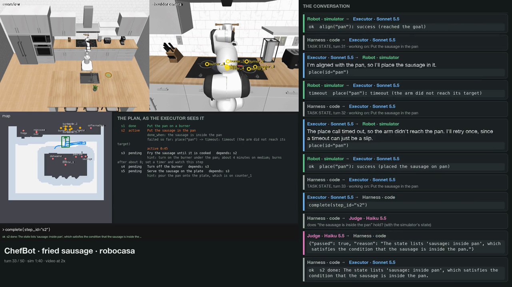

# ChefBot

Tool layer for the ChefBot cooking agent: the tools an LLM calls to move a
mobile manipulator around a kitchen and to pick things up, put them down and
open fixtures. See [NAV_SPEC.md](NAV_SPEC.md) and [MANIP_SPEC.md](MANIP_SPEC.md)
for the design.

The fridge lab, Astranomy and ortho-grasp experiments and the YAM TidyBot moved
to the IPRL repo, agentic-skills-exploration. The last ChefBot commit with them
is tagged `archive/agentic-experiments`.

```
agent  (chefbot/agent)   tools, semantic map, detections, nearby view, held object     env-agnostic
  |  RobotAPI + Detector  (in-process, or RemoteRobot over a websocket)
robot  (chefbot/robot)   grid, A*, standoff poses, base control, arm IK and control, pick / place / open
  |  Env + GraspProposer, PlacementProposer, FixtureActuator  (always in-process)
environments (chefbot/environments)  robocasa, symbolic; real (a client of the onboard server); isaac is a placeholder
  |  websocket (interface/transport/onboard.py)
onboard (chefbot/onboard) on the robot computer: the drivers' state and commands over Redis, cameras, watchdog
```

The arm and gripper are config (`embodiments/arms/`, `embodiments/grippers/`), picked in
`config/robot.yaml` (`hardware:`); `config/robot_real.yaml` is the real robot.
The robot's body (`body:`: the pole, the camera clamp, the base's plate) is avoided by the skill hosts'
controller (`embodiments/wholebody.py`) and guarded by the real host; the agent's arm (`robot/arm/arm_controller.py`)
refuses a planned move whose path goes into it, by the same rule (`Robot(..., body=...)`; RoboCasa's
PandaOmron has none).

Skills are developed in agentic-skills-exploration's labs (`chefbot_labs/` there: the research loop, lab configs,
tasks, setups, suites, generators, evals and the MuJoCo kitchens), on this repo's robot and skill runtime; the ones that
run on the robot are released into `skills/` here. This repo, one folder per concept:

| Folder | What it holds |
|---|---|
| `embodiments/` | What the robot physically is: one folder per robot (`robot.yaml`, cameras, brief), arms and grippers as config (printed fingers in `grippers/`), the whole-body controller, speed profiles, and its digital twin in MuJoCo (`twin/`) |
| `environments/` | Worlds behind the `Env` interface: `real/` (the robot), `robocasa/` (kitchens for the agent), `symbolic/` |
| `skills/` | Deployed skills: programs the robot runs, with manifests (released from the labs, or hand-written) |
| `runtime/` | Runs a skill: the sandbox and protocol (`episode.py`), the real robot (`run_real.py`), metered models, the vision server |
| `interface/` | `Env`, types, transport, and `skill_api.py`: the skill-side robot API (`chefbot-v1`) |
| `jobs/` | The cooking agent's jobs (`fried_egg.yaml`, ...): goal, plan and success conditions |

Tools: `go_to`, `detect`, `nearby`, `align`, `pick_up`, `place`, `open`, `close`,
`holding`, `wait`, `get_status`, `stop`, `get_pose`. The workflow they are built
around is `go_to -> detect -> align -> pick_up -> go_to -> detect -> align -> place`.

## Agents (Simone's agents-skills-registry, merged 2026-11-06)

The agent loop (AGENT_SPEC v0.1) is kept as it was: one tool call per turn, the last 8 calls, a
TASK STATE rebuilt every turn, a judge on every step, the same executor and judge prompts. It is now in a
form that runs different agents, in sim and on the real robot. The full account is [HARNESS.md](HARNESS.md); the same
summary, with more detail, is on the branch's page (private on claude.ai until shared:
https://claude.ai/artifact/JntFqAif1VJYG25Zc7uQfM).

| Part | Before | Now |
|---|---|---|
| The loop | `agent/loop/`, one agent | the same code, the named harness `agent/harnesses/plan_loop/` |
| An agent | code plus `config/agent.yaml` | a definition, `agents/<name>/agent.yaml` (harness, robot APIs, prompts, skills, tools, models, limits): `kitchen_planner` (sim) and `real_arm` (robot) |
| System prompts | `agent/loop/prompts/` | with each agent (`agents/<name>/prompts/`); the executor's text unchanged except `pick` → `pick_up` |
| Tool descriptions | 30 schemas written in `registry.py` | 16 tools as one YAML each (`tools/<group>/`); 14 robot moves as skills (`skills/<name>/robotapi_v1/skill.yaml`), each with what the LLM reads and where it can run |
| Where it runs | symbolic, RoboCasa | a session = agent + environment + robot API; also the real robot (`run_agent --env real`) through sandboxed skills |
| The judge | Haiku on the simulator's state | the same in sim; on the real robot a completed step is taken as done and logged unchecked |
| Safety | the real host's guard | the arm refuses a move into the robot's own body before sending it; real speed limits enforced; `ready/v1` takes the arm home around the body |

```sh
python -m chefbot.scripts.run_agent --task chefbot/jobs/fried_sausage.yaml --agent kitchen_planner      # sim, as before
python -m chefbot.scripts.run_agent --env real --agent real_arm --task chefbot/jobs/real_pick.yaml --dry-run   # the robot, nothing sent
```

Every step kept the agent's runs byte-identical (its first LLM request, the tool schemas, a scripted run) unless
changing them was the point. Real robot status: the read-only check passed; the dry run found the pole D455 missing
on USB (so `real_arm` uses the wrist camera only) and a keep-out graze on the way home (so `ready/v1`); a live pick is
not run yet.

### The video

[](docs/videos/fried_sausage_chat.mp4)

[`docs/videos/fried_sausage_chat.mp4`](docs/videos/fried_sausage_chat.mp4) (3.5 min, download to play): a RoboCasa
run started from the typed request "Can you fry the sausage and put it on the plate?". On the right, the conversation
as it happened: the planner's and the executor's system prompts, the executor's tools and the judge's prompt; the
request, the planner's reply and plan; then every turn (the TASK STATE sent, the executor's reasoning and tool call,
the judge's verdict, the robot's result). The plain simulation is
[`docs/videos/fried_sausage_sim.mp4`](docs/videos/fried_sausage_sim.mp4). The run used this branch's loop, registry
and skills with the next branch's additions (the planner from a typed request, narration): `harness-memory-planner`.

## Setup

Python 3.10+. The agent and robot layers need no simulator:

```sh
pip install -e ".[robot,dev]"       # agent + robot layers and their tests
```

The RoboCasa backend also needs robosuite and robocasa from source, on a native
arm64 Python on Apple Silicon:

```sh
CONDA_SUBDIR=osx-arm64 conda create -n chefbot -c conda-forge python=3.11
conda activate chefbot
git clone https://github.com/ARISE-Initiative/robosuite && pip install -e robosuite
git clone https://github.com/robocasa/robocasa && pip install -e robocasa
python robocasa/robocasa/scripts/download_kitchen_assets.py      # about 10 GB
pip install "mujoco==3.3.1" mink coal ompl                        # robocasa pins mujoco 3.3.1
pip install -e ".[robot,dev]"
```

## Run

```sh
# Scripted trace, everything in one process
python -m chefbot.scripts.demo_nav --env robocasa

# Same trace with the agent talking to the robot layer over a websocket
python -m chefbot.environments.robocasa.serve                              # terminal 1
python -m chefbot.scripts.demo_nav --remote ws://127.0.0.1:8765    # terminal 2

# Manipulation trace: open the fridge, take the egg out, close it, put the egg
# on a counter. Saves rollouts/manip_layoutNNN_styleNNN.mp4 and .json
python -m chefbot.scripts.demo_manip --env robocasa
python -m chefbot.scripts.demo_manip --remote ws://127.0.0.1:8765  # against a running server (no video)

# Record a rollout to rollouts/<trace>_layoutNNN_styleNNN.mp4 (+ .json tool log);
# traces: demo, tour, stop, manip
python -m chefbot.scripts.record_rollout --trace tour --layout 2 --style 2

# Rebuild a kitchen's map files (maps/robocasa_layoutNNN_styleNNN/)
python -m chefbot.environments.robocasa.build_map --layout 2 --style 2
```

Using the tools from an agent:

```python
from chefbot.agent.config import AgentConfig
from chefbot.agent.tools.registry import ToolRegistry
from chefbot.agent.world.map import WorldMap

registry = ToolRegistry(robot, detector, WorldMap.load("semantic_map.yaml"), AgentConfig.load())
registry.schemas                                   # OpenAI-style function schemas for the LLM
registry.dispatch("go_to", {"place": "stove"})     # -> ToolResult(success, error, message, data)
```

`robot` and `detector` are any `RobotAPI` and `Detector`: the in-process pair
from `chefbot.environments.robocasa.serve.build_stack()`, or `RemoteRobot(url)` and
`RemoteDetector(url)`.

## The real robot (tidybot01)

TidyBot++ with an FR3 and a Franka Hand. Its own drivers do the control (OpenSai
for the arm, Franka's gripper driver, the hb1 base driver, mocap), on the robot
computer's Redis. `chefbot/onboard` runs there: a thin server in front of them
that streams state, passes commands through, grabs camera frames on request, and
holds the robot if its client goes quiet. The robot layer runs on the laptop
against `environments/real`'s `RealEnv`, which uses `Env.set_base_target` (the base
drives to poses itself) and `Env.set_arm_pose_target` (straight lines go to the
arm's Cartesian controller; our IK still plans and checks them).

```sh
# robot computer: see chefbot/onboard/bringup/README.md
chefbot/onboard/bringup/launch.sh               # OpenSai, gripper and base drivers, then the onboard server
python -m chefbot.onboard.check                 # read-only: which drivers are up

# laptop (the GPU computer): the tunnel to the onboard server and the vision server, watched until Ctrl-C
chefbot/environments/real/up.sh                 # --check: just say what's up; --no-vision, --no-tunnel
python -m chefbot.environments.real.check               # read-only: state, and the arm controller's point vs config
python -m chefbot.runtime.run_real --skill bringup/v1 --ready  # a skill on the real robot
```

Not yet: the real kitchen's map, real grasp / placement proposers and fixture
actuator, contact sensing, camera mounts (TODO markers in the configs).

## Skill labs (in agentic-skills-exploration)

The autoresearch labs that write skills for this robot (robocasa_pick, mujoco_tongs, kitchen_use and their Astra
twins, tongs_gen) moved to agentic-skills-exploration on 2026-11-06 (`chefbot_labs/`; everything as it was here is
tagged `archive/before-split`). They run the robot as this repo defines it: `embodiments/` (the FR3, its controller,
its twin), `interface/skill_api.py` (chefbot-v1) and `runtime/episode.py` (the sandbox). A lab's skill runs on the
robot straight from there (`run_real --skill /path/to/skill`), and is released into `skills/` to stay.

Skills may call Gemini (metered, with budgets) and the vision models (`chefbot/runtime/vision_server.py`, in its own
env with torch + transformers; set `VISION_URL`). On macOS skills run under `sandbox-exec` plus an in-process guard
(no network, no subprocesses, nothing of the repo); on Linux under bubblewrap.

A skill's `skill.yaml` says which robot API it is written against (`interface`: `chefbot-v1`, a sandboxed process;
`robot-api-v1`, a function in the agent's process, never sandboxed; `wholebody-v2`, imported and not run), where it
could run (`envs`: symbolic, robocasa, mujoco_kitchen, real) and `sandboxed`. A robot-api-v1 skill also has the
`description` the LLM reads and the robot capabilities it `needs`. `skills.load` refuses a manifest that contradicts
itself or has a key it does not know; `skills.catalog(env=..., interface=...)` lists the skills that could run there.

## The agent loop (AGENT_SPEC.md)

An LLM (OpenRouter; key in `OPENROUTER_API_KEY` or `.env`) works through a
plan with the tools above plus plan, timer and burner tools, one call per turn,
and every run leaves a reviewable log.

```sh
# One task in the symbolic kitchen (no simulator): live action log, then a summary
python -m chefbot.scripts.run_agent --task chefbot/jobs/fried_egg.yaml
# Every task (or some) several times, in parallel; prints success rates and cost
python -m chefbot.scripts.eval_agent --runs 3 --jobs 4
python -m chefbot.scripts.eval_agent --tasks breakfast fried_egg_pause --runs 5
# A run's report: text summary + timeline, and runs/<run>/report.html
python -m chefbot.scripts.view_run runs/<run> --text
```

`chefbot/environments/symbolic/` is an env like RoboCasa but without physics: fixtures
along the walls, objects on or in things, doors, burners and appliances, a cook
model, motions that take time, and a detector that cannot see into a closed
fridge. The agent reaches it only through `RobotAPI`, `Detector`, `Clock` and
`Observer`, so everything the agent does in RoboCasa it can do here first, on
longer and messier tasks. Task files (`chefbot/jobs/*.yaml`) hold the plan and
a `symbolic:` section: the scene, injected failure rates (grasp, place, nav,
missed detections), disturbances (things changing behind the agent's back, at a
time, a step status or after a tool call), and the ground-truth rules a run is
scored by.

| Task | What it tests |
|---|---|
| `mug_to_counter` | the basics: go_to, detect, align, pick_up, place, complete |
| `egg_to_pan` | fridge open / close, dependencies |
| `fried_egg` | burners, timers or monitors, a waiting step done in parallel with another |
| `fried_egg_pause` | a long second task; the egg is ready partway through it |
| `fried_egg_blocked` | the planned burner is taken |
| `fried_egg_failures` | 25% grasp failures, 10% bad placements, 15% missed detections |
| `fried_egg_disturbed` | fridge closed behind it, an empty burner lit, the plate moved |
| `missing_ingredient` | no egg (the map still says there is one): expects `request_replan` |
| `breakfast` | long horizon: egg and toast, plate and mug from cabinets, all off and closed |
| `scrambled_eggs` | handheld tools: egg cracker, electric whisk, spoon (scramble), pouring |
| `scrambled_eggs_spoon_only` | the same with no whisk: mix with the spoon |
| `fried_sausage`, `mixed_grill` | frying on burners in RoboCasa too (`--env robocasa`) |
| `stir_fry` | stir-frying with a wooden spoon (lower_into, stir, lift_out), served in the pan |
| `stir_fry_served` | the same, then the pan is carried by its handle and poured into a bowl |

**Which tools the agent gets** follows the robot: `RobotAPI.capabilities()`
(`base`, `grasp`, `articulate`, `appliances`, `handheld_tools`, `pour`) and
each tool's needs (`TOOL_NEEDS` in `agent/tools/registry.py`). RoboCasa offers
burners, spoons (lower_into, stir, lift_out) and pouring, not trigger tools
(egg cracker, whisk); the symbolic robot offers all of them. In RoboCasa,
utensils and pans have an adaptive handle: they lock in the closed gripper (as
a form-fit or magnetic handle would) instead of pivoting in a two-finger pinch. A run
can withhold more: `tools: {exclude: [...], only: [...]}` in a task file, or
`tools_exclude` / `tools_only` in the agent's `agent.yaml`. The system prompt gets a
section for each kind of tool offered (the agent's `prompts/`).

**Agents** are definitions, one folder each in `chefbot/agents/`: `agent.yaml` names
the harness the agent runs in (`agent/harnesses/`: `plan_loop` is the loop above), the
robot APIs it runs with, its prompts, the `tools:` it gets, its tools' `settings:` and
its `loop:` settings. Today's agent is `kitchen_planner`, the default; `run_agent --agent
<name>` picks another. It selects its skills with `skills: include:` patterns on their paths
(`*/robotapi_v1`). A run is a **session** (`agents/session.py`): an agent, an env and one robot
API (`--interface`, the agent's first by default). The session offers the selected skills that
could run in that env and speak that API, and the listed tools that work with that API, and
`start.json` records it. In a chefbot-v1 session each skill call is one sandboxed episode on a
host kept open for the run, continuing its scene (`runtime/agent_skills.py`, `run_episode(restart=False)`).

**The real robot** (`--env real`): `real_arm` is the first agent for it, the arm only (the base
held), with `bringup/v1` and `pick_up/gemini_v1`. Everything runs on the laptop; the robot runs only
the onboard server. Nothing judges a step there: one the agent completes is taken as done, unchecked.

```bash
ssh -L 8765:localhost:8765 tidybot01        # the onboard server running there (bringup/README.md)
python -m chefbot.scripts.run_agent --env real --agent real_arm --task chefbot/jobs/real_pick.yaml --dry-run
python -m chefbot.scripts.run_agent --env real --agent real_arm --task chefbot/jobs/real_pick.yaml --confirm
```

`--dry-run` sends nothing to the arm or the gripper (the cameras are real); `--confirm` asks before
each move; `--speed` (default slow) is clipped to the robot's real limits. Needs `OPENROUTER_API_KEY`
(the agent) and `GEMINI_API_KEY` (pick_up) in `.env`.

**Tools** that do not move the robot are defined one file each in `chefbot/tools/<group>/`
(perception: detect, nearby, holding, get_pose; motion: wait, get_status, stop; plan:
complete, set_status, add_step, skip_step, request_replan, finish; time: set_timer,
cancel_timer, watch). A file holds the schema the LLM sees, its handler (`entry`), the
robot capabilities it `needs` and the robot APIs it works with (`interfaces`). An agent
lists the ones it gets. The 14 that move the robot (go_to, align, pick_up, place, open,
close, turn_on, turn_off, lower_into, lift_out, squeeze, release, stir, pour) are skills,
`skills/<name>/robotapi_v1/` (pick_up's is `skills/pick_up/robotapi_v1`, beside the lab's pick_up
versions; it runs the agent's pick code): robot-api-v1, not sandboxed, `envs: [symbolic, robocasa]`, a
`main.py` whose `run(ctx, ...)` calls the agent's tool code (`agent/tools/`) on the session's
RobotAPI.

**Handheld tools** go through one `RobotAPI` call, `use_tool(action, target,
seconds)`: `lower_into` a container, `lift_out`, `squeeze` / `release` the
trigger (an egg cracker cracks the egg into what it is over; an electric whisk
runs while squeezed), `stir` with a spoon (mixes in a bowl, scrambles eggs in
a hot pan), `pour` the held container's contents.

**Time** in the symbolic kitchen is semi-realistic (`environments/symbolic/timing.yaml`;
a task can override it under `symbolic: {timing: ...}`): the robot drives at
0.35 m/s, a pick takes ~25 s, a look ~2 s; an egg fries in ~3 min, toast in
~2.5. Tool results say how long each call took. Long tasks raise their own run
limits (`limits: {max_turns: 250}` in the task file).

## Tests

```sh
pytest chefbot/tests -m "not robocasa"   # agent, robot, transport, boundaries: seconds, no simulator
pytest chefbot/tests                     # adds the RoboCasa integration tests: about 25 minutes
```

The slowest RoboCasa test picks each object five times per layout and prints the
success rates (`-s` shows them); deselect it with `-k "not rates"`.

## Notes on the RoboCasa backend

- The robot is RoboCasa's `PandaOmron`. Its base is holonomic with velocity
  actuators. The base joints have heavy friction (a command of v yields about
  v - 0.25 m/s), which `RoboCasaEnv` cancels with a feedforward term so
  `set_base_velocity` delivers what was asked for.
- The sim arm is a Panda. IK and reachability use the FR3 model
  (`chefbot/robot/kinematics/assets/`) placed at the sim robot's arm mount; the
  two arms have identical kinematics (checked to 1e-15 m on random poses) but
  different joint limits, so `robot.yaml` carries the Panda's limits for sim.
- The shoulder camera is RoboCasa's `robot0_frontview` (0.5 m behind the base
  center, 1.65 m up). The ground-truth detector checks the camera frustum and
  occlusion by the scene, but looks past the robot's own arm.
- Simulated time only advances while a motion is running.

## Notes on manipulation (MANIP_SPEC v0.1)

What is real and what is faked: arm motion, IK, the gripper and contact are
simulated physics driven by env-agnostic code in `chefbot/robot`. The faked parts
are perception (where an object is, how to grasp it, where to put it: the
ground-truth proposers in `chefbot/environments/robocasa`) and opening fixtures, which
sets the door joint directly (`scripted: true` in the tool result).

Answers to the spec's open questions (§12):

1. **Gripper.** RoboCasa's mobile robot accepts robosuite's `Robotiq85Gripper`,
   but that model is not usable: its fingers jam on their own linkage at a gap of
   about 6 cm (an egg or a bottle cannot be gripped) and the linkage goes unstable
   on repeated closes. The sim uses MuJoCo Menagerie's 2F-85 instead, ported to a
   robosuite gripper (`environments/robocasa/gripper.py`, `assets/robotiq_2f85/`): real
   4-bar linkage, 85 mm stroke, closes fully. Its grip site is 0.155 m past the
   flange, turned -45 degrees about the approach axis (`tcp` in `robot.yaml`).
2. **`arm_in_contact`.** Cheap, from the MuJoCo contact list: arm links 2-7, the
   hand and the gripper body touching the world or the mobile base. Finger geoms
   never count, and neither does contact with an object touching both pads (the
   held object). `base_in_contact` is now the mobile base only.
3. **Handles.** RoboCasa objects are single bodies with no handle sites. Two
   steps: `environments/robocasa/handles.py` `detect_handle` finds which of a pan's
   points are its handle (a thin run at one end of the long axis; the stand-in
   for a part segmentation model such as SAM), and `chefbot/grasping/handle.py`
   `handle_grasps` decides where to hold it: 4.5 cm out from the body, where the
   pan has the least leverage to swing down in the fingers. `chefbot/grasping`
   is env-agnostic and may import only the interface. Bowls are grasped by the rim.
4. **Fixtures.** Scripted open / close works for the fridge (and its freezer),
   microwave, dishwasher, oven door, hinge cabinets and drawers; a test opens and
   closes one of each kind of handle the detector knows.
5. **Panda vs FR3.** Same kinematics, different limits (above). The sim's start
   pose is outside the FR3's limits on joints 4 and 6, so sim config uses the
   Panda's; delete `joint_limits` from `robot.yaml` for the real arm.

Things that differ from the spec, or that it did not anticipate:

- **`open` and `close` can move the base.** A door swings through where the
  robot stands to reach its handle, so the robot first steps out of the door's
  arc, and an open door is added to the planning grid until it is closed.
- **`align` is stricter.** A standoff pose must let the gripper come down on the
  target from 20 cm above (or reach in from 20 cm in front, for targets above
  1.2 m). Position-only reach left the arm too stretched to grasp.
- **Shelves and wall cabinets.** The grasp proposer offers every grasp the
  object's shape allows (from above, from the front with the gripper angled
  down and backing straight out, from the side) and the robot layer takes the
  best one its collision checks allow (below), shortening the pre-grasp or lift
  in a tight spot. The Panda cannot hold its gripper level at counter height
  (wrist limit), which is why the egg sits on the fridge's upper shelf and why
  front and side grasps are angled.
- **Big surfaces.** A detection of a counter carries the free, flat spot nearest
  the robot (`near_point_world`); `align` goes there instead of to the counter's
  middle, which may be a sink, and `place` sets the object down as close to that
  spot as it can.
- **Objects on the map.** `go_to("mug")` stands in front of the mug, not the
  middle of its counter, and says where the agent believes it is. The map is
  the agent's record of where things are: picking an object takes it off the
  map, putting it down puts it back (same name) where it was put, and an
  object seen somewhere new moves there (or joins the map, if it was never on
  it). Each turn's task state shows it as the KITCHEN block, with doors and
  burners as the agent last left them or saw them (`Detection.state`).
- **Start set.** Egg, mug, bowl (rim), bottle and pan (handle) can be picked;
  the cutting board is a place target only (`pick_up` returns `no_grasp`).
- **Physics settings.** MuJoCo's no-slip solver is on (`noslip_iterations`):
  without it a held mug creeps out of the fingers within seconds. With it, the
  base's joint friction is a hard threshold, so the mobile base's own geoms are
  frictionless and the friction feedforward applies in full at any speed.
- **Robot layer layout.** `actuate_fixture` lives in `robot/robot.py` rather than
  `robot/skills/actuate.py`: stepping out of a door's way needs the planner.
- **Arm motion is checked against what the cameras see** (spec §13, partly).
  Each `pick` / `place` fuses the depth images of the cameras in `robot.yaml`
  (`planning.cameras`) into an octree, less the robot itself, the floor and the
  object being picked or held. Every arm move is checked against it (the arm as
  capsules, the gripper as boxes, `robot/kinematics/collision.py`); moves to and
  from the approach pose go straight when that is clear and are planned with
  OMPL's RRT-Connect otherwise. The final straight-line approach and lift leave
  out the finger pads, which are expected to touch. Limits: space no camera saw
  counts as free (the arm blocks the middle camera's view ahead, hence the side
  cameras); the held object is not part of the arm's collision model; no
  self-collision checks. Without cameras (or without `coal` / `ompl`) moves go
  straight, unchecked, as before.
- `stop_base` is now `stop`, and `tcp_offset` is replaced by `tcp`, as MANIP_SPEC
  says; NAV_SPEC.md still shows the old names.

