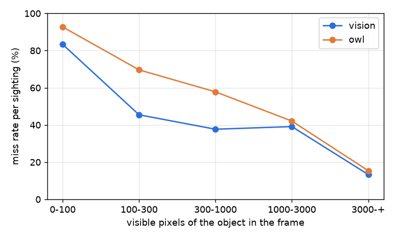
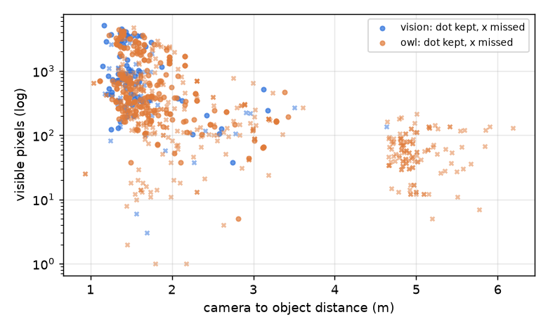
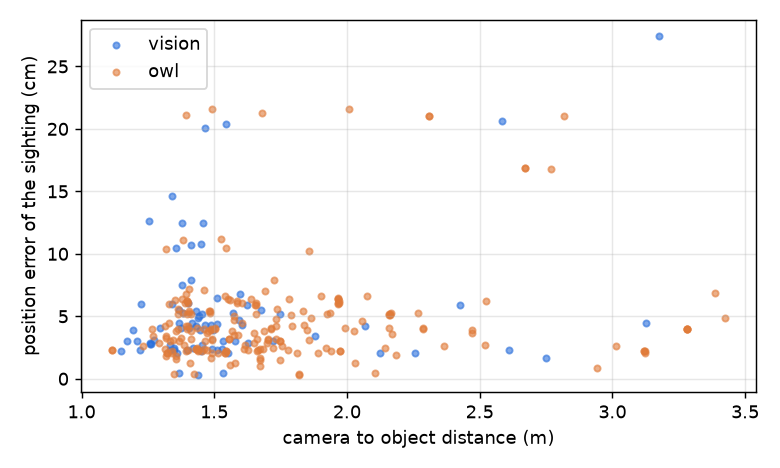

# Why the camera detectors miss or misplace objects

A root cause analysis of the VLM and OWLv2 detectors, over the saved exploration runs. No new VLM
calls were made.

## Method

The run logs keep every frame a detector saw (`vision/NNN.png`), what it named in it and where
that put things (`vision/NNN.json`). They do not keep the camera pose, the depth image or what was
hidden. The scripted route is deterministic, so `chefbot/explore/rootcause.py` replays each run's
tool calls in the same scene and stands the robot exactly where the run logged it. At every call
that produced a detector frame, it renders the same camera with RGB-D and a segmentation image.

Each logged frame is matched to the replayed view by image. The replayed images are identical to
the logged ones (mean pixel difference 0.07 to 2.7 out of 255). 361 of 363 frames matched; the 2
unmatched ones are left out.

For every true object in every frame, the sighting table (`docs/root_cause/sightings.csv`,
1085 rows) records:

- whether it was in the camera's view, and how many pixels of it were visible (hidden ones count 0)
- its distance from the camera, the viewing angle, its physical size, and whether it touched the
  image edge
- the detector's outcome:
  - **kept:** a detection of its label within 0.3 m of it, with the position error
  - **dropped:** named right, but then thrown away by the edge filter, by depth landing on the
    background, or by the other filters
  - **wrong label:** a box over it, named something else
  - **not named:** visible, but no box over it
- OWLv2's score for the right label over the boxes on it, below the threshold too (OWLv2 rerun
  locally on every saved frame)

Per object, `docs/root_cause/objects.csv` gives the furthest stage it reached over all its frames,
and so why it was missed.

Runs:

| detector | runs | route |
|---|---|---|
| VLM | `2026-10-19_184125` (layout 1), `2026-10-20_144100`, `144336`, `144626` (layouts 7, 25, 39) | earlier route: no cabinets or drawers opened, front camera (the arm blocks the fridge) |
| OWLv2 | `2026-10-25_145221` (layout 1), `2026-10-25_175806`, `181121`, `182428` (layouts 7, 25, 39) | current route: cabinets and drawers opened, the camera the arm blocks least |

## 1. Where objects get lost

Each object of each run (48 per detector):

| cause | VLM | OWLv2 | objects |
|---|---|---|---|
| found | 31 | 25 | |
| never visible | 10 | 5 | VLM: egg, milk (fridge blocked by the arm), plate, fork, bowl. OWLv2: plate, fork (cabinet or drawer it cannot open or reach), bowl (microwave out of reach) |
| visible, but named something else | 4 | 9 | VLM: milk as bottled water or bottled drink, bowl as plate, cup as mug. OWLv2: egg as bar soap (4), milk as bottled water (3), lemon as pickle or apple, bowl as cutting board |
| kept in some frames, then lost in the map | 0 | 5 | OWLv2: spoon (became fork, or pizza cutter and scissors), cup and mug (swapped), lemon (became sponge) |
| visible, too few pixels (under 300) | 2 | 2 | VLM: egg (136 px), pan (83 px). OWLv2: egg, plate |
| named right, then dropped by the edge filter | 1 | 1 | apple, mug |
| visible, not named | 0 | 1 | plate |

- **VLM:** most misses were never visible (10 of 17). That is the earlier route; the current route
  opens cabinets and drawers and uses a camera with the fridge in view. Its visible misses are
  mostly labels (4) and too few pixels (2).
- **OWLv2:** most misses are visible but named wrong (9 of 23), or kept and then lost in the map
  (5).

## 2. Pixels and distance

Per sighting (an object visible in one frame):

| visible pixels | VLM sightings | VLM kept | VLM wrong label | OWLv2 sightings | OWLv2 kept | OWLv2 wrong label |
|---|---|---|---|---|---|---|
| 0 to 100 | 6 | 17% | 17% | 165 | 7% | 31% |
| 100 to 300 | 22 | 55% | 18% | 191 | 30% | 46% |
| 300 to 1000 | 61 | 62% | 21% | 173 | 42% | 43% |
| 1000 to 3000 | 23 | 61% | 4% | 76 | 58% | 11% |
| 3000 and more | 15 | 87% | 0% | 26 | 85% | 4% |



| camera to object | VLM kept | OWLv2 kept | median visible px (OWLv2) |
|---|---|---|---|
| 1.0 to 1.5 m | 72% | 53% | 655 |
| 1.5 to 2.0 m | 45% | 39% | 377 |
| 2.0 to 3.0 m | 58% | 31% | 146 |
| over 3 m | 50% (4 sightings) | 7% | 65 |

- **Miss rate falls steadily with pixel size, with a clear knee.** Under 300 px, objects are
  rarely kept (VLM 45%, OWLv2 under 30%). Above 3000 px, both keep about 85 to 87%.
- **OWLv2's wrong labels are a pixel problem.** It names 43 to 46% of sightings under 1000 px as
  something else, against 11% at 1000 to 3000 px. The VLM is less sensitive: about 20% wrong
  labels up to 1000 px, then near 0.
- **Mean distance:**
  - VLM: kept 1.56 m (734 px median), not kept 1.75 m (417 px).
  - OWLv2: kept 1.76 m (447 px), not kept 2.83 m (147 px).
- Distance matters through pixels. At the robot's usual standoff (1.2 to 1.5 m), a lemon, egg or
  spoon covers only about 100 to 500 px.



## 3. Position error

The median error of kept sightings is 4.2 cm (VLM) and 3.9 cm (OWLv2). It barely depends on
distance (correlation +0.27 VLM, +0.16 OWLv2) and not at all on pixel size (+0.05, +0.03).

The error comes from turning a box into a point: the box centre's depth includes background and
the visible side of the object, not its middle. Getting closer would not reduce it much; a
tighter object mask would.

Of the sightings named right but dropped later:

- **edge filter:** VLM 18, OWLv2 25
- **depth at the box centre landed on the background:** VLM 5, OWLv2 4
- **depth hit the object, but a later filter dropped it:** VLM 1, OWLv2 28. These are the
  height, footprint and 4 m range filters; most of OWLv2's are views from 4 to 6 m away, beyond
  the range limit.



## 4. Model quality

- **OWLv2 scores for the right label, on objects in view:**
  - median 0.265
  - 61% at or above its 0.2 threshold, 69% at 0.15, 79% at 0.10
  - per label: lowest for the plate (0.03), milk (0.11), bottled water (0.12) and lemon (0.18);
    highest for the cutting board (0.51) and mug (0.43)
- **Its confusions are systematic, not noise:**
  - bottled water as condiment bottle (23 sightings)
  - cup as mug (21)
  - banana as sponge (19)
  - lemon as pear (18) or avocado (16)
  - spoon as knife (12)
  - egg as bar soap

  Lowering the threshold would also admit more false finds (22 extra finds at 0.15 on layout 1).
- **The VLM's wrong labels are mostly near-synonyms:** cup and mug (6), milk as bottled water or
  bottled drink (2), apple as tomato (2), pan as bowl (2), lemon as lime or avocado.

## 5. What would recover objects, ranked

| fix | what it addresses | expected gain | cost |
|---|---|---|---|
| 1. Label vote per spot: keep the label seen most often at a spot, instead of "a closer view's name wins" | OWLv2 kept the right label in many frames (up to 32) and lost it to one other name | OWLv2 +5 of 48 objects (10%); VLM 0 here | small code change in the tracker, free |
| 2. Zoom on small or uncertain boxes: run the detector again on an enlarged crop around each box under about 1000 px, or with a low-margin label | too few pixels; OWLv2's wrong labels under 1000 px | OWLv2 up to about 6 to 9 more (eggs, lemons, milk, small plate), VLM about 2 to 4 (egg, pan, cup, milk), if crops behave like the 1000 to 3000 px band (58 to 61% kept, 4 to 11% wrong label) | one extra detector call per small box (VLM about $0.004 each; OWLv2 free) |
| 3. Go closer to small or uncertain objects (approach to about 0.6 to 0.8 m, or use the wrist camera) | the same objects as fix 2, with real pixels instead of upsampled ones | similar to fix 2, and more reliable for labels | a new action per candidate (time; navigation near counters) |
| 4. A better or bigger model, or a stricter prompt | VLM near-synonyms (cup and mug, milk); OWLv2 fine-grained confusions | VLM about +2 to 3 (milk, bowl, cup); OWLv2 depends on the model | a different model, prompt work, or a cup and mug equivalence in the scorer |
| 5. Re-look instead of the edge filter dropping a box cut off by the image edge | right labels dropped at the edge (VLM 18 sightings, OWLv2 25) | 1 object each here (other views usually catch it) | small: turn a little and detect again |
| 6. A mask (e.g. SAM) instead of the box centre for depth | position error (about 4 cm) and depth landing on the background | error down, and up to about 9 dropped sightings back | one segmentation model call per box |

- **Fixes 1 and 2 first.** They are cheap and address the largest visible losses. Fix 1 is free
  and applies to both detectors.
- **Getting closer (fix 3)** pays off mainly for small objects, and mainly for labels. It does not
  reduce position error, which is about the same at every distance.
- **A better model (fix 4)** matters most for OWLv2, whose confusions persist even at 300 to
  1000 px. The VLM's remaining label errors are near-synonyms, which a stricter prompt or a scorer
  equivalence (cup and mug) would largely cover.
- **On the current route,** "never visible" is down to drawers too low for the arm and a cabinet
  the robot cannot open. That is a reach problem, not a perception one.

## Reproduce

```
python -m chefbot.explore.rootcause runs/<run> [runs/<run> ...] --out <folder> --owl-scores
python -m chefbot.explore.rootcause runs/<run> [...] --out <folder> --analyze
```

The first writes `sightings.csv`. The second writes the tables, `objects.csv` and the three plots.

## 6. Fixes tried on layout 7 (OWLv2, current route, free)

Same kitchen and route each time; 14 objects. "Go closer" means: after each fixture or cabinet group,
the robot stands about 0.7 m from up to 2 objects the detector has only seen small (under 1000 px),
looks again, and lets the name vote merge the views.

| setup | found | missed | wrong names on real objects | false finds | xy median / p90 (cm) | extra stops | run time |
|---|---|---|---|---|---|---|---|
| baseline | 9/14 | egg, fork, lemon, milk, plate | egg as bar soap, lemon as pear or pickle, milk as bottled water | 22 | 3.0 / 9.8 | 0 | 12.8 min (shared machine) |
| vote | 8/14 | cup, egg, fork, lemon, milk, plate | egg as bar soap, milk as bottled water | 9 | 2.8 / 9.9 | 0 | 5.8 min |
| vote + zoom | 9/14 | cup, fork, milk, plate, spoon | cup as jello cup, milk as bottled water, spoon as spatula | 9 | 2.2 / 9.8 | 0 | 16.6 min |
| vote + go closer | 9/14 | egg, fork, lemon, milk, plate | egg as bar soap, lemon as sponge, milk as bottled water | 10 | 2.9 / 11.1 | 20 (0 unreachable) | 31.8 min |
| vote + zoom + go closer | 7/14 | bottled water, cup, fork, milk, mug, plate, spoon | bottled water as condiment bottle, milk as bottled water, mug as ice cream, spoon as spatula | 12 | 2.0 / 9.6 | 8 (0 unreachable) | 6.7 min |

The last run also had two cost changes: a nearly identical view reuses the last answer, and a
small spot is zoomed only once. That is why it is faster than "vote + zoom".

What this shows:

- **The vote helps most:** false finds drop from 22 to 9, at no cost. But it keeps a name OWLv2
  gets wrong most of the time (the cup read as a mug).
- **The zoom finds small things** (egg, lemon) and tightens positions (median about 2 cm), but its
  enlarged crops bring new wrong names (jello cup, spatula, ice cream, condiment bottle).
- **Going closer did not change OWLv2's names.** Up close, the egg is still "bar soap", the milk
  still "bottled water", the lemon "sponge". Most of its 20 stops went to OWLv2's own false finds,
  which are also seen small (wooden spoon, ladle, spatula, spray, pizza cutter), and the route took
  about 2.5 times longer. Every chosen standing spot was reachable on this kitchen.
- So with OWLv2 the limit is the model's naming, not the view. Going closer would pay off with a
  detector whose names improve with pixels (the VLM's wrong names fell to near 0 above 1000 px) and
  if it only approaches objects with a fair score, not every small box.

The VLM run with vote and zoom on layout 7 (approved, about $0.30) stopped partway when the session
was shut down: $0.19 spent, 43 calls (27 views and 16 zooms), no result. It has not been rerun.

Runs: vote `2026-10-25_220505`, vote + zoom `2026-10-25_221115`, vote + go closer
`2026-10-26_081003`, vote + zoom + go closer `2026-10-26_084214` (all `..._layout007`).

## 7. Other models, compared offline on the saved pictures (free)

The test set is every real object visible in the 361 saved detector pictures (758 sightings on the
pictures each model ran on). Each model is scored by whether a box on the object carries the right
name, a wrong one, or none. Runs locally on the Mac, with no API calls. The tool is
`chefbot/explore/naming_bench.py`; the full table is in `docs/root_cause/naming_bench.md`.

| model | named right | wrong name | not named | false finds per picture | seconds per picture |
|---|---|---|---|---|---|
| VLM (saved answers, only the 74 pictures it saw, 127 sightings) | 78% | 17% | 5% | 0.6 | (API) |
| OWLv2, as the explorer uses it | 43% | 36% | 21% | 1.6 | 1.6 |
| OWLv2 boxes, renamed by SigLIP 2 | 50% | 23% | 27% | 1.3 | 2.1 |
| SigLIP 2 naming each real object's own box (naming only) | 56% | 29% | 15% | 0 | 3.7 |

Named right, by the object's visible pixels:

| model | under 100 | 100 to 300 | 300 to 1000 | 1000 to 3000 | over 3000 |
|---|---|---|---|---|---|
| VLM | 17% | 73% | 75% | 91% | 100% |
| OWLv2 | 13% | 39% | 45% | 78% | 93% |
| OWLv2 boxes + SigLIP 2 | 29% | 52% | 63% | 47% | 56% |
| SigLIP 2 on the true boxes | 39% | 61% | 68% | 51% | 49% |

- **SigLIP 2 (`google/siglip2-so400m-patch14-384`) names small objects much better than OWLv2:**
  63% against 45% at 300 to 1000 px, and 52% against 39% at 100 to 300 px. But it is worse on big
  ones, because it picks the near-synonym the catalogue also holds: pan as saucepan (41), lemon as
  lime (32), cup as coffee cup.
- **A hybrid would take the best of both:** OWLv2's name for boxes over 1000 px, SigLIP 2's under.
  Estimated from the bins, about 56% named right overall, against OWLv2's 43%. It costs about 0.5 s
  per small box, and nothing in API calls.
- **The VLM is still clearly best at naming:** 78%, and 91 to 100% above 1000 px. Its wrong names
  are near-synonyms too (cup and mug, apple as tomato, pan as bowl).
- **Many remaining errors are near-synonyms in our own word list** (cup, mug, coffee cup; pan,
  saucepan; lemon, lime). Grouping those as equivalent, or trimming the list, would recover a large
  share for every model.
- **Grounding DINO successors did not work here.** LLMDet (`iSEE-Laboratory/llmdet_tiny`) gave
  boxes outside the picture and subword names ("##er") with the full word list, on both the GPU and
  the CPU. That matches the known transformers weight-loading issue. MM Grounding DINO
  (`openmmlab-community/mm_grounding_dino_tiny_o365v1_goldg_v3det`) gave zero-width boxes even with
  five words. Neither was scored.
- **SAM 3 / 3.1 could not be tried:** the weights are gated (HTTP 401 without a Hugging Face login).
  To enable it: accept the license on huggingface.co/facebook/sam3 (or sam3.1) with a Hugging Face
  account, then log in on this Mac (`hf auth login`, or `huggingface-cli login`, with a read token).

### Depth from a SAM 2.1 mask instead of the box centre

For the 275 kept sightings with a box from the detector, `facebook/sam2.1-hiera-small` segmented the
object in the box, and the point was taken from the mask's own pixels:

| | 3D error median | 3D error p90 | mask better than box |
|---|---|---|---|
| VLM boxes (75) | 4.0 cm with the box, 2.8 cm with the mask | 7.3 vs 6.8 cm | 64% |
| OWLv2 boxes (200) | 3.8 vs 3.3 cm | 7.6 vs 7.6 cm | 61% |

The mask helps most where the box catches a lot of background (the bowl: 11.0 to 5.1 cm). It does
little for long or flat objects (cutting board, pan), where the camera sees a surface away from the
object's middle. SAM 2.1 takes about 1 s per box on the Mac.

### Recommendation

1. **Hybrid naming, free:** OWLv2 boxes, with SigLIP 2 renaming boxes under 1000 px. About +13
   points of objects named right over OWLv2, no API cost.
2. **Treat near-synonyms in the word list as one name** (cup, mug, coffee cup; pan, saucepan;
   lemon, lime), or trim the list. This helps every model, the VLM included.
3. **For the best names, use the VLM,** and pair it with going closer: its names improve with
   pixels, unlike OWLv2's.
4. **SAM 2.1 masks for depth:** a modest gain (about 0.7 cm median); worth it only if position
   matters more than run time.
5. **SAM 3** stays to be tried once a Hugging Face login with Meta's license is available.

## 8. Hybrid naming and near-synonyms as one name (free)

- **Hybrid** (`owl.hybrid_siglip` in `chefbot/explore/config.yaml`, off by default): OWLv2 names
  boxes of 1000 px and more, and SigLIP 2 names smaller ones. A SigLIP 2 name that is a kitchen part
  drops the box.
- **Aliases** (the `aliases` table in `chefbot/explore/config.yaml`; `vision.use_aliases`, off by
  default): a static list of near-synonym groups in the word list:
  - mug: cup, coffee cup, glass cup
  - pan: saucepan, frying pan, skillet
  - lemon: lime, lemon wedge
  - bottled water: water bottle, bottled drink

  The detector reports the group's name. The scorer and the accuracy report always compare names
  by group, so earlier runs are scored the same way here.

### Offline, the 758 sightings of real objects

Full table in `docs/root_cause/naming_bench_aliases.md`.

| model | named right | wrong name | not named | false finds per picture |
|---|---|---|---|---|
| OWLv2 | 43% | 36% | 21% | 1.6 |
| OWLv2, aliases | 50% | 30% | 21% | 1.6 |
| hybrid (OWLv2, SigLIP 2 under 1000 px) | 54% | 24% | 23% | 1.5 |
| **hybrid, aliases** | **63%** | **15%** | 23% | 1.5 |
| VLM (its 127 sightings) | 78% | 17% | 5% | 0.6 |
| VLM, aliases | 86% | 9% | 5% | 0.6 |

With aliases, the hybrid names 74% right at 300 to 1000 px (OWLv2: 45%) and 62% at 100 to 300 px
(OWLv2: 39%).

### Layout 7, OWLv2, current route (14 objects, scored with aliases)

| setup | found | missed | wrong names on real objects | false finds | xy median / p90 (cm) | run time |
|---|---|---|---|---|---|---|
| baseline | 9/14 | egg, fork, lemon, milk, plate | egg as bar soap, lemon as pear or pickle, milk as bottled water | 22 | 3.0 / 9.8 | 12.8 min (shared machine) |
| vote | 8/14 | mug, egg, fork, lemon, milk, plate | egg as bar soap, milk as bottled water | 9 | 2.8 / 9.9 | 5.8 min |
| vote + zoom | 9/14 | mug, fork, milk, plate, spoon | milk as bottled water, mug as jello cup, spoon as spatula | 9 | 2.2 / 9.8 | 16.6 min |
| **vote + hybrid + aliases** | **9/14** | mug, fork, milk, plate, spoon | milk as bottled water | **8** | 2.3 / 9.8 | 11.7 min |
| exact detector (reference) | 13/14 | fork | none | 0 | 0.1 / 0.1 | 9.2 min |

- **The hybrid finds the small things** (the egg and the lemon), cuts wrong names to one (milk as
  bottled water), and gives the fewest false finds so far. Positions are as good as with the zoom.
- **The count stays at 9/14 for two reasons:**
  - The spoon is not found by any OWLv2 setup.
  - With aliases, the cup and the mug (21 cm apart on counter_1) both read as "mug", and the
    tracker merges same-named sightings within 30 cm into one object. One of them is lost.

  Aliases should come with a smaller merge radius for same-name sightings (for example 0.1 m), or
  keep the two names apart in the tracker and merge them only for scoring.
- The milk (always "bottled water") and the plate and fork (a cabinet and drawer the robot cannot
  open or reach) are not perception problems this can fix.
- **SAM 3 is still to be tried:** no Hugging Face login was found on the Mac.

## 9. Two like things side by side, and SAM 3 (free)

### Cup and mug kept apart: layout 7 reaches 10/14 with OWLv2

With aliases, the cup and the mug (21 cm apart) both read as "mug". Two things merged them into one
object:

- **The detector's tracker:** with aliases, a group name now merges sightings only within 12 cm
  (`vision.alias_merge_radius`).
- **The agent's map:** objects seen from beyond the map query's range now take same-label map
  entries one to one, nearest pairs first.

| layout 7, OWLv2, current route | found | missed | wrong names on real objects | false finds | xy median / p90 (cm) | run time |
|---|---|---|---|---|---|---|
| baseline | 9/14 | egg, fork, lemon, milk, plate | 4 | 22 | 3.0 / 9.8 | 12.8 min (shared machine) |
| vote + hybrid + aliases | 9/14 | mug, fork, milk, plate, spoon | 1 | 8 | 2.3 / 9.8 | 11.7 min |
| **vote + hybrid + aliases, the fix** | **10/14** | fork, milk, plate, spoon | 2 (milk as bottled water, spoon as banana) | 12 | 2.9 / 11.1 | 15.3 min |
| exact detector | 13/14 | fork | 0 | 0 | 0.1 / 0.1 | 9.2 min |

### SAM 3, offline (`facebook/sam3`, transformers `Sam3Model`)

Access is through the Hugging Face login with Meta's license; it runs locally.
`facebook/sam3.1` ships only `sam3.1_multiplex.pt`, a video-focused checkpoint for Meta's own code,
so the image test uses SAM 3.

- **Too slow for the whole word list:** about 7 s per picture for one prompt and 20 s for eight, on
  both the Mac GPU and the CPU. That is about 10 minutes per picture for the ~230 names.
- **So it checks candidates instead:** each OWLv2 box gets SigLIP 2's 3 best names plus OWLv2's
  own, and SAM 3 prompts them all on the picture. A box takes the name whose SAM 3 mask overlaps
  it best.
- **Sample:** every 6th saved picture (61 pictures, 113 sightings of real objects; the VLM had only
  11 of them).

| model (same 61 pictures) | named right | wrong name | not named | false finds per picture | seconds per picture |
|---|---|---|---|---|---|
| OWLv2 | 42% | 36% | 21% | 1.6 | 0.8 |
| OWLv2, aliases | 50% | 28% | 21% | 1.6 | 0.8 |
| hybrid, aliases | 65% | 12% | 23% | 1.6 | 0.85 |
| **SAM 3 picking among SigLIP 2's top 3, aliases** | **71%** | **5%** | 24% | **1.1** | **19.7** |
| VLM, aliases (11 sightings) | 100% | 0% | 0% | 0.8 | (API) |

By pixel size, SAM 3 with aliases names 76% right at 100 to 300 px and 80% at 300 to 1000 px. The
hybrid gets 66% and 73%, and OWLv2 48% and 57%.

- **SAM 3 is the best free namer here:** wrong names at 5%, and the fewest false finds of the local
  models, because its masks reject boxes that hold nothing of the proposed names. It does not find
  more objects: the "not named" share is OWLv2's, since OWLv2 still proposes the boxes.
- **It is about 23 times slower than the hybrid:** about 20 s per picture on the Mac. A layout 7
  run has about 100 pictures, so it would add about 30 minutes. It suits a second look at uncertain
  boxes only, not every picture.
- **Position from SAM 3's masks was not measured separately.** Its masks would enter the depth the
  same way as SAM 2.1's (section 7: median 3D error 3.9 down to 3.2 cm).

### Recommendation now

1. **Default for free runs: OWLv2 + hybrid + aliases + vote,** with the side-by-side fix. That is
   10/14 on layout 7, at no API cost and about the same run time.
2. **SAM 3 as a checker only for uncertain or small boxes:** the best local naming (5% wrong), when
   about 20 s per checked picture is acceptable.
3. **The VLM remains the best namer** (78 to 86% over its full set). Pair it with going closer for
   the small objects.
